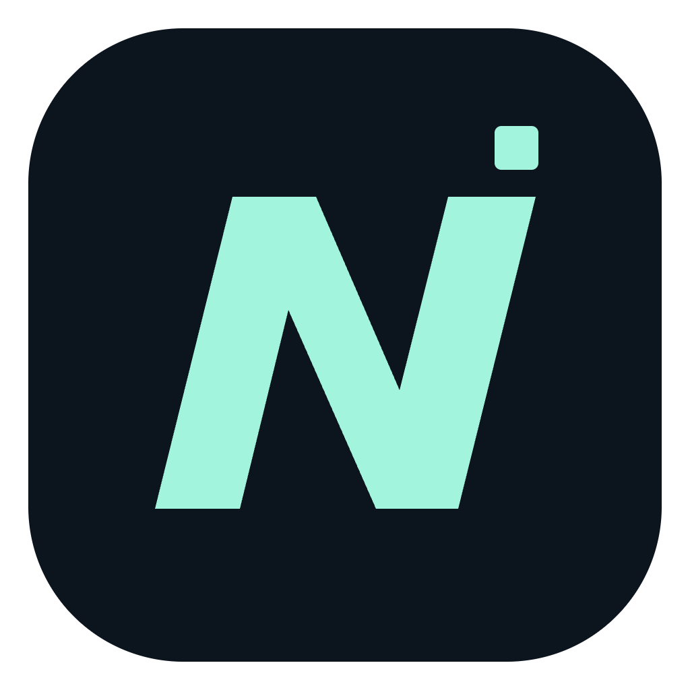

<h1 align="center">
  <br>
  NOVA Studio
</h1>

<p align="center">The desktop AI client for <a href="https://cdkai.cc">cdkai.cc</a> · 中文说明见下方</p>

NOVA Studio brings every model on the NOVA API into one desktop app: chat, knowledge bases, agents and
MCP tools. Sign in with a cdkai.cc account and the app sets up an API key for this computer, shows your
balance and opens the top-up page. Conversations and settings stay on your computer, and the app sends no
usage analytics or crash reports.

**Download:** <https://cdkai.cc/studio>

## Based on Cherry Studio

NOVA Studio is a modified version of [Cherry Studio](https://github.com/CherryHQ/cherry-studio) by the
CherryHQ team, released under the [GNU Affero General Public License v3.0](LICENSE). The first commit
of this repository imports Cherry Studio unchanged at upstream commit
[`c2efa48`](https://github.com/CherryHQ/cherry-studio/commit/c2efa48fc09f85ef7e6eaf70f3d4a969b69f55af);
every later commit is a NOVA change. [NOVA-NOTICE.md](NOVA-NOTICE.md) lists what was changed, and
Cherry Studio's original README is kept in [README.cherry-studio.md](README.cherry-studio.md).

NOVA Studio is not made by or affiliated with the Cherry Studio team, and does not connect to any of
their services.

## Building

Requires Node.js 24.12 and pnpm 12.6 (see `.node-version` and `package.json`).

```sh
pnpm install --frozen-lockfile
pnpm build:unpack        # unsigned app in dist/ for a quick look
pnpm build:mac           # or build:win; installers in dist/
```

Build from a path without spaces: native add-ons fail to compile otherwise. The
[NOVA Studio release build](.github/workflows/nova-release.yml) workflow builds Windows and macOS
installers on GitHub's runners (Actions → NOVA Studio release build → Run workflow).

---

## 中文

NOVA Studio 是 [cdkai.cc](https://cdkai.cc) 的桌面 AI 客户端：在一个应用里使用 NOVA API 的全部模型，支持对话、
知识库、智能体与 MCP 工具。使用 cdkai.cc 账户登录后自动配置 API Key，并可查看余额、打开充值页面。对话与设置保存在本地，
不发送使用统计或崩溃报告。下载地址：<https://cdkai.cc/studio>

NOVA Studio 基于 CherryHQ 团队的开源项目 [Cherry Studio](https://github.com/CherryHQ/cherry-studio) 修改而来，
按 [AGPL-3.0](LICENSE) 许可证发布。本仓库第一个提交原样导入 Cherry Studio 上游提交 `c2efa48`，之后的提交均为 NOVA 的修改，
修改内容见 [NOVA-NOTICE.md](NOVA-NOTICE.md)。NOVA Studio 与 Cherry Studio 团队无关，也不连接其任何服务。
